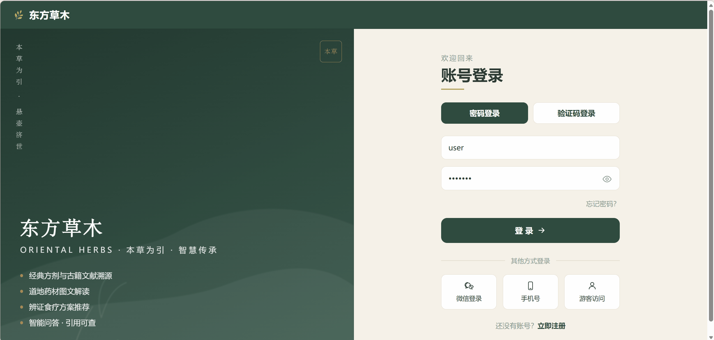
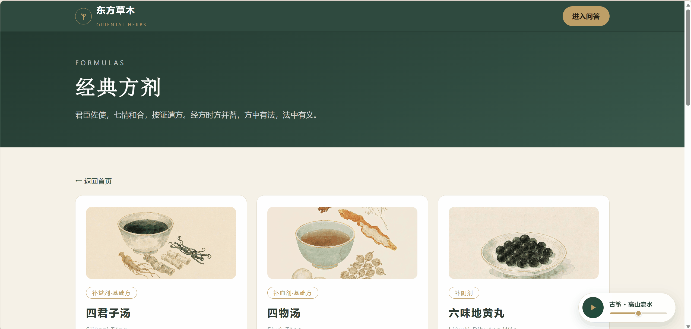
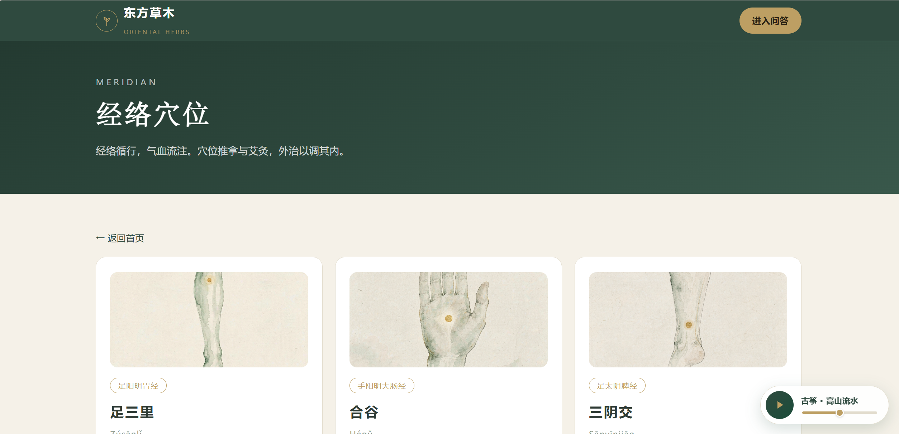
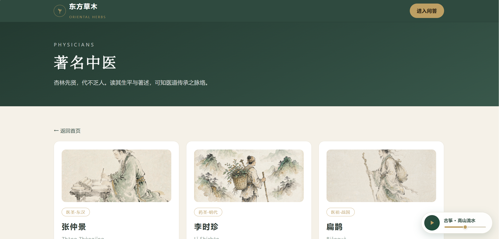
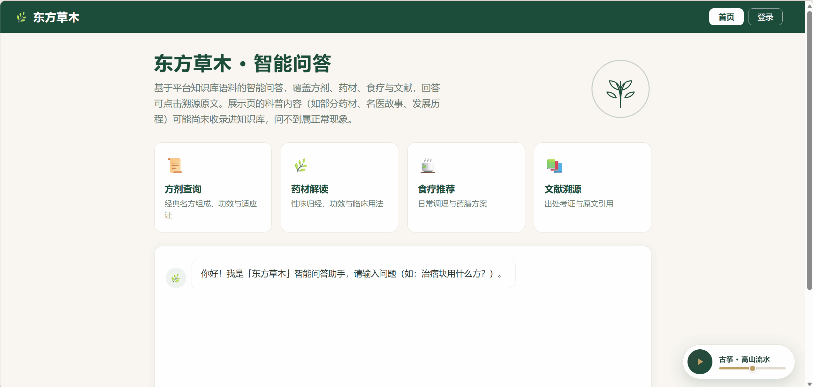
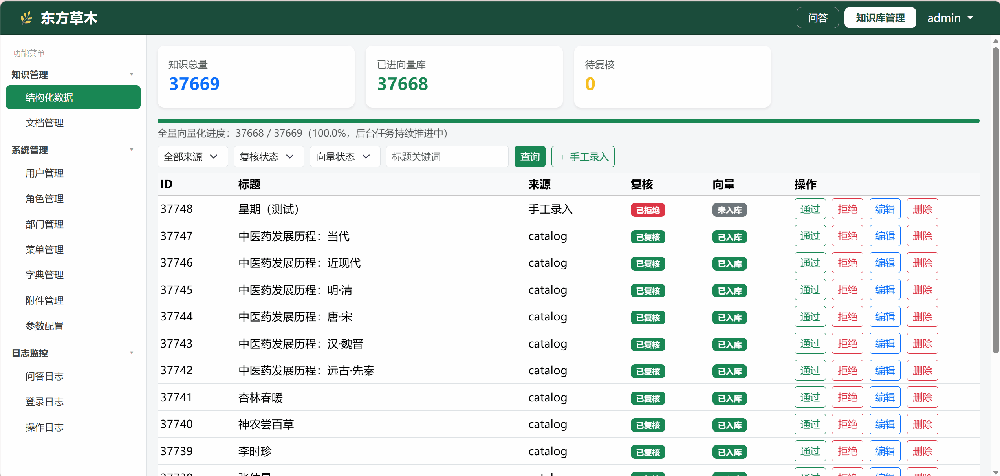

# 东方草木 · ORIENTAL HERBS

> 面向大众的中医药文化科普平台：主页展示本草文化（药材 / 名医 / 历史故事 / 发展历程），智能问答基于 RAG 知识库流式作答，后台管理员维护知识语料。

---
## 一、演示实例






## 一、项目概览

| 模块 | 地址 | 说明 |
|---|---|---|
| 主页 | `/` | 品牌首页：知识分类（本草 / 方剂 / 名医 / 故事 / 发展历程等）、明星药材、问询导览 |
| 分类列表 | `/list/?type=herb` | 按 `type` 浏览：herb 药材 / formula 方剂 / diet 食疗 / meridian 经络 / constitution 体质 / classic 古籍 / doctor 名医 / story 故事 |
| 内容详情 | `/detail/?id=ginseng` | 性味归经、功效主治、方解等富文本详情 |
| 发展历程 | `/history/` | 中医药发展史纵向时间轴（6 个纪元） |
| 智能问答 | `/qa/` | RAG 流式问答，回答带引用溯源，可从主页/详情页带问题跳转（`/qa/?q=...`） |
| 登录页 | `/admin/login.html` | 账号登录（RBAC 分权） |
| 注册页 | `/admin/register.html` | 自助注册：仅创建普通用户（role 3），注册成功自动登录跳前台 |
| 知识管理后台 | `/admin/` | 语料上传 → 审核 → 向量化 → 问答生效，含用户/角色/菜单/字典/日志管理 |
| 健康检查 | `/api/health` | 确认服务存活 |

**页面门禁**：浏览类页面（主页/列表/详情/历程/问答）需登录后访问；后台仅 role 1（管理员）可进，普通用户（role 3）访问返回 403。

**账号体系（RBAC）**

| 账号 | 密码 | 角色 | 权限 |
|---|---|---|---|
| `admin` | `admin123` | 超级管理员（role 1） | 全部页面 + 后台全部功能 |
| `user` | `user123` | 普通用户（role 3） | 仅前台，后台 403 |

角色定义：`1=超级管理员，3=普通用户`。测试密码仅限本地演示，对外部署前务必修改。

**注册接口**：`POST /api/sys/register`（用户名 ≥3 字符、密码 ≥6 位；昵称/手机号选填）。接口把 `role_id` 固定写死为 3，不接收前端传入的角色字段，无法自助注册管理员；重名返回 `code=1`，成功后返回 token 直接登录。

---

## 二、启动服务

项目根目录（Windows + uv 环境）：

```bash
uv run uvicorn com.tcm.main:app --port 8000 --reload
```

看到 `Uvicorn running on http://127.0.0.1:8000` 即启动成功。服务启动时会**后台自动预热**检索链路（加载 1.3GB 向量模型 + 构建 BM25 索引），预热完成前发起的第一条提问可能仍需等待，之后单条问答约 2~3 秒。

依赖：MySQL（连接配置在 `.env`）、DeepSeek API Key（`DEEPSEEK_API_KEY`）、本地嵌入模型（`models/`）。

---

## 三、常用命令

> 均在项目根目录执行；服务占用的终端保留，另开终端跑。

| 想干什么 | 命令 |
|---|---|
| 清洗原始语料入库（幂等） | `uv run python -m com.tcm.etl.clean` |
| 增量向量化新入库内容 | `uv run python -m com.tcm.rag.embedding --limit 0` |
| 重算某一条 | `uv run python -m com.tcm.rag.embedding --one 123` |
| 命令行检索测试 | `uv run python -m com.tcm.rag.retriever "治痞块的方子" 5` |
| 命令行问答测试 | `uv run python -m com.tcm.qa.graph "治痞块用什么方"` |
| 重建 BM25 关键词索引 | `uv run python -c "from com.tcm.rag import bm25; bm25.build(rebuild=True)"` |
| 导入前台科普内容到知识库 | `uv run python scripts/import_catalog_kb.py`（幂等，按 src_fid 去重） |
| 系统表初始化（幂等） | `uv run python -m com.tcm.system.init_db` |
| 召回质量测试 | `uv run python -m com.tcm.rag.test_recall` |

---

## 四、内容体系（两套数据，各司其职）

1. **前台展示内容** —— `static/data/catalog.json`
   主页 / 列表 / 详情 / 时间轴页读取的策划内容：药材、方剂、食疗、经络、体质、古籍、名医、历史故事、发展历程（共 30+ 条，13 张本草插画在 `static/img/`）。
   由手工维护；问答如需覆盖某类内容，用 `scripts/import_catalog_kb.py` 导入知识库并向量化（当前已导入名医 / 故事 / 发展历程三类，检索命中率 0.7~0.8）。

2. **知识库语料** —— MySQL `knowledge` 表 + Chroma 向量库（`chroma_db/`，46 万 chunk）
   问答助手的数据源：原始方剂 / 中药 / 偏方语料（约 3.7 万条）+ 后台上传的文档。后台全流程管理：上传 → 待复核 → 通过 → 自动向量化 → 问答可检索；编辑单条会自动同步向量库并使 BM25 失效重建。

---

## 五、技术架构

```
前端   原生 HTML/CSS/JS（内联样式防缓存）+ Bootstrap（qa/admin），墨绿+米白+金线新中式风格
后端   FastAPI（同步路由 + SSE StreamingResponse 流式问答）
RAG    bge 本地向量模型(CPU) + Chroma 向量检索 + BM25(jieba+术语词典) 关键词检索 → RRF 混合排序
问答   LangGraph 两节点图（retrieve → generate），DeepSeek 流式生成，带 [n] 引用标注与 0.5 拒答阈值
数据   MySQL（knowledge / sys_* / qa_log / oper_log 等）+ Chroma 持久化
权限   Token + RBAC（sys_user.role_id），后台接口统一守卫
```

**性能要点**（踩过的坑）：
- BM25 索引按「来源行数」做增量判断，内容不变时复用缓存，不会每次提问重建；
- 服务启动后台线程预热（模型 + BM25），冷启动等待发生在启动阶段而非用户提问时；
- 问答路由用同步 `def` + StreamingResponse，避免同步调用阻塞事件循环；
- `import torch` 必须在 langchain/langgraph 之前（Windows DLL 冲突，段错误无提示）。

---

## 六、目录速查

```
com/tcm/
  main.py             FastAPI 启动入口（含 RAG 预热）
  cfg/settings.py     配置（读 .env）
  db/conn.py          MySQL 连接池
  etl/clean.py        原始语料清洗入库
  rag/embedding.py    切片 + 向量化 + 增量
  rag/retriever.py    混合检索（向量 + BM25 → RRF）
  rag/bm25.py         BM25 索引与 RRF 融合
  rag/service.py      管理端业务逻辑
  rag/api.py          管理端接口
  qa/graph.py         LangGraph 问答图（retrieve → generate）
  qa/api.py           问答 SSE 接口
  system/             RBAC：auth / api / init_db（账号、角色、菜单、日志）
  admin/api.py        后台 /api/admin/* 接口
static/
  index.html          主页（东方草木）
  list/  detail/      分类列表 / 内容详情
  history/            发展历程时间轴
  qa/                 智能问答页（css/js + 内联样式）
  admin/              登录页 + 后台页
  data/catalog.json   前台科普内容（30+ 条）
  img/                13 张新中式国风插画
scripts/
  import_catalog_kb.py  科普内容 → 知识库导入（幂等）
docs/
  jiaofu/             项目交付文档（概要/数据库/接口/部署/操作手册）
  check/              测试脚本与演示
sql/                  建表 SQL
models/               本地嵌入模型
chroma_db/            向量库数据
uploads/              后台上传的文件
```

更完整的设计说明见 `docs/jiaofu/`（03 概要设计、04 数据库设计、05 接口设计、12 部署手册、13 用户操作手册）。

---

## 七、常见问题

| 现象 | 原因 / 处理 |
|---|---|
| 页面样式突然错乱 | 浏览器缓存了旧 HTML/CSS；Ctrl+F5 强刷，页面样式均已内联，刷新即恢复 |
| 端口被占用 | 换端口：`--port 8001` |
| 第一条问答很慢 | 启动预热未完成（后台在建索引），等预热日志出现后再试 |
| 问答拒答"没有找到相关内容" | 相关内容未入库/未向量化：后台审核通过跑 embedding，或用导入脚本补科普内容 |
| 普通用户进后台 403 | 正常，role 3 无后台权限；用 admin 登录 |
| 向量化慢 | CPU 跑大模型约 3.2 秒/条，增量跑会自动续 |
| 改代码没生效 | 加 `--reload`，或手动重启服务 |
| 进程崩溃且无报错 | Windows DLL 冲突：检查 `import torch` 是否被挪到 langchain 导入之后 |


